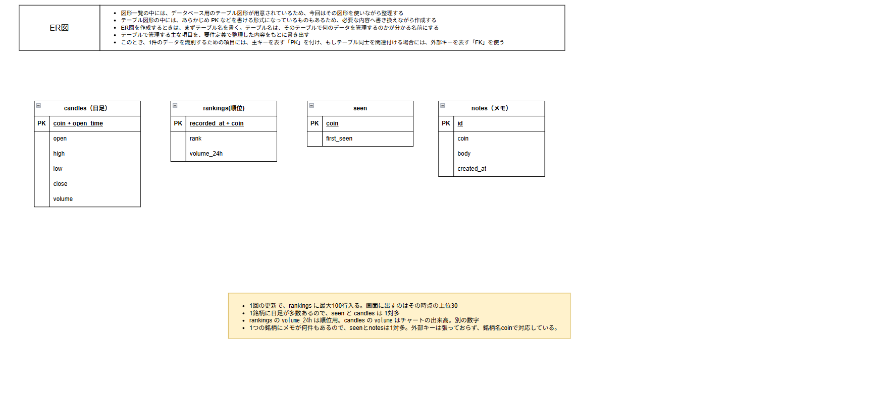
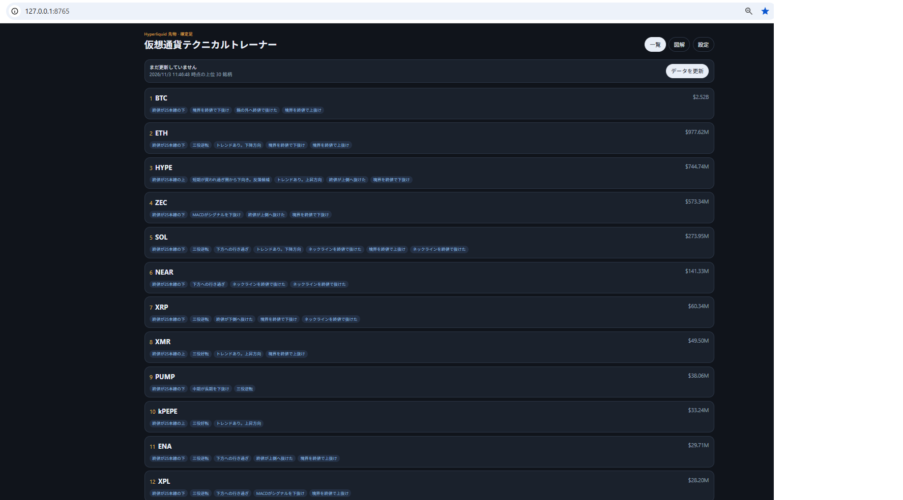
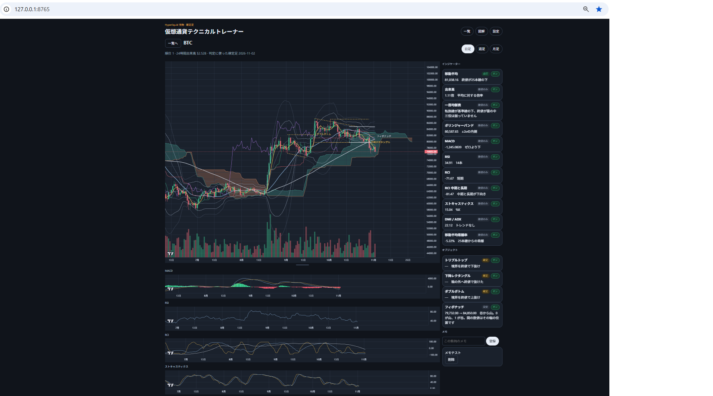
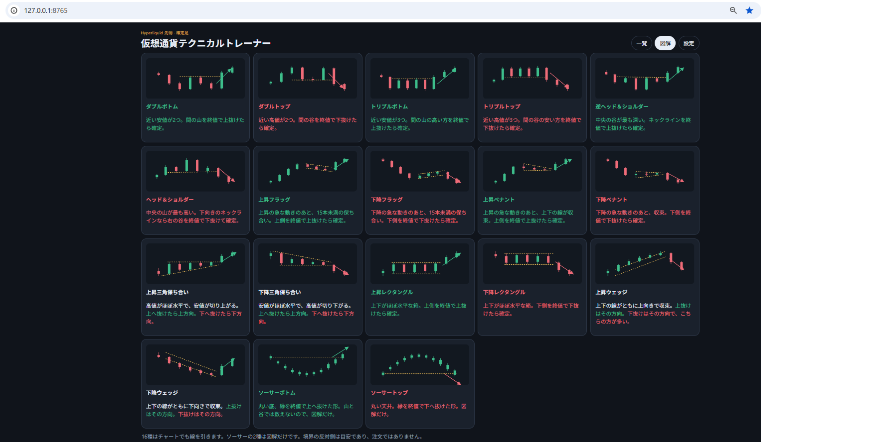
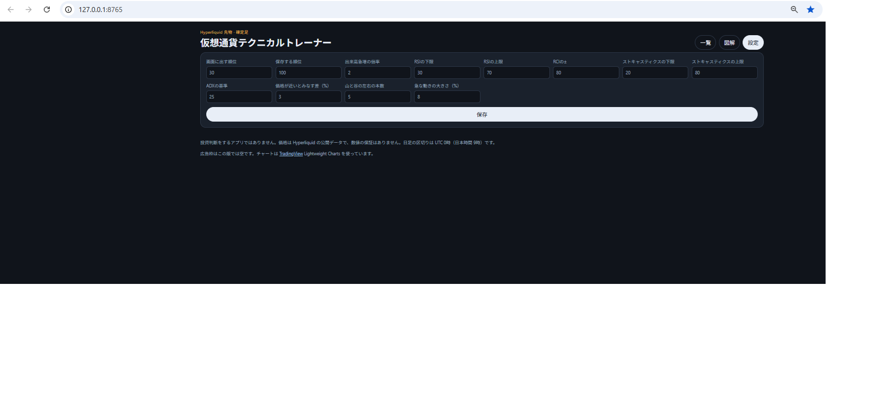

# 仮想通貨テクニカルトレーナー  ～テクニカルを学ぼう！～

## 概要

Hyperliquid本体先物の出来高上位100銘柄を保存し、更新時点の上位30銘柄を一覧にする。日足のチャートに指標とパターンの線を引き、状態を表示する。それらを見てテクニカル分析の勉強に使えるアプリケーション。

## 背景

私は投資関係の勉強をしています。どの証券会社の独自のツールでも各種分析をできるものになっていますが、典型的なチャートパターンを表示し勉強できる物がないと思い作ろうと考えました。  
ここからが苦労、工夫した点ですが、できれば日本株、米国株での分析を目指しましたが、調べていく中でチャートの利用に利権・システムでの問題がありました。  
そのため、解決策として仮想通貨(Hyperliquid）であれば利権・システムの点で実現可能で、APIにてデータ取得ができ効率的にデータ処理をするシステムが作れるとわかりました。  
しかし、仮想通貨でも問題点があり、チャートパターンが先の値動きに影響を与えるのか？という点疑問が残ります。  
そのため、大量の銘柄の中で取引量の多い上位30件に絞り市場心理が反映されやすい銘柄を表示し、勉強する意味が生まれる事を目指しました。  
また、製作においてAIに相談をしながら進め、悩む点やコードの修正など助言をもらいながら進めました。  
典型的だと思いますが、コードで字下げがうまくできておらずエラーになった際なども自分で見直しても解決できない時などAIにチェックを依頼するとエラー部分を見つける事ができ心から頼れるパートナー、先生のような存在と実感しました。  
今後も利用しながら改善を進め、通貨にバックテストを行い、どのチャートパターンがどの通貨で未来推察に有用かなどの検証を行っていきたいと考えています。また今回は時間の関係で間に合いませんでしたが、フロントエンドの修正なども行っていきます。

## 使用技術

- フロントエンド: HTML、CSS、JavaScript、TradingView Lightweight Charts
- バックエンド: Python の標準ライブラリ
- データベース: SQLite
- 外部API: Hyperliquid の公開API

## ER図

## 画面

### 一覧

更新時点の出来高上位と、点灯・発生・確定の短いラベル。

### 銘柄詳細

選んだ銘柄の確定足、指標、パターン、自分のメモ。

### 図解

パターン18種の説明。ソーサーは図解だけ。

### 設定

判定に使う数値を変更して保存する。

## 起動方法

Python 3 が必要です。追加のインストールはありません。

1. このフォルダで `python app.py` を実行する。`起動.bat` でも同じです。
2. ブラウザで http://127.0.0.1:8765 を開く。自動で開きます。
3. 初回は Hyperliquid からデータを取るため、一覧が出るまで数分かかります。インターネットが必要です。